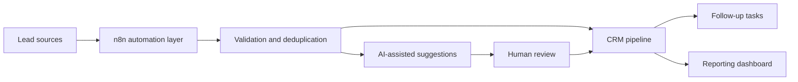

# Madar AI

**Real-estate workflow automation | Python prototype + AI-assisted platform roadmap**

[](https://github.com/shaimaamo1/madar-ai/actions/workflows/python-tests.yml)


Madar AI explores ways to connect lead intake, CRM organization, and follow-up workflows for real-estate teams. This repository includes a **small, runnable, rule-based Python lead-triage demonstration** and a roadmap toward a larger AI-assisted system using n8n.

> **Scope:** The Python demo is implemented and has unit tests. A production CRM, AI agent, n8n integrations, and real messaging automation are **not** published in this repository.

## Try the Working Demo

**Requirements:** Python 3.11+; standard library only. No API keys, service accounts, or installation required.

From the root of this repository:

```bash
python examples/lead_triage_demo.py
```

The included `examples/sample_leads.csv` contains **fictional test records**. The demo checks essential fields, skips duplicate contacts, assigns transparent rule-based priority scores, and prepares follow-up drafts **for human review only when contact consent is recorded**.

Expected summary for the included sample:

| Result | Count |
| --- | ---: |
| Leads accepted | 3 |
| Duplicate contacts skipped | 1 |
| Rows rejected as invalid | 1 |

To test the code:

```bash
python -m unittest discover -s tests -v
```

The five local unit tests cover priority scoring, consent, invalid budgets, duplicates, and missing CSV columns. The GitHub Actions workflow runs this test suite on relevant pushes and pull requests.

To use a different local CSV:

```bash
python examples/lead_triage_demo.py --input path/to/leads.csv
```

Required column names: `lead_id, name, email, phone, area, budget_egp, property_type, contact_consent`.

Optional `--output path/to/report.json` saves a report locally. **Do not commit real customer contact details or generated reports to a public repository.**

### What the Demo Does (and Doesn't)

| Included now | Future work |
| --- | --- |
| Read a local CSV, validate fields, and skip duplicate contacts | Connect approved lead-intake sources |
| Calculate explainable, rule-based priority scores | Evaluate AI-assisted lead summaries and classifications |
| Respect recorded contact consent and prepare draft text | Human-reviewed messaging integrations |
| Produce a reviewable JSON result | CRM sync, monitoring, error handling, and dashboards |
| Run standard-library tests | Integration and end-to-end testing |

**This is not an AI model or a finished business product.** No customer messages are sent and no data are uploaded.

## The Business Problem

Real-estate teams may spend time moving inquiries between messaging platforms, spreadsheets, and separate customer lists. Without a consistent pipeline, duplicate records and forgotten next steps can be difficult to spot.

## Proposed Architecture



This diagram is the **planned architecture**, not an illustration of a deployed system. The current offline prototype implements only CSV validation, basic deduplication, priority scoring, and draft generation.

## Roadmap

- [x] Publish a working offline Python lead-triage example with synthetic data.
- [x] Add unit tests and GitHub Actions test configuration.
- [ ] Define a documented CRM data model and MVP success metrics.
- [ ] Add an importable n8n workflow and sanitized integration examples.
- [ ] Build error handling, idempotency, and human approval steps.
- [ ] Implement a secure CRM integration with consent-aware outreach.
- [ ] Publish a recorded end-to-end demo and deployment instructions.

## Repository Map

```text
madar-ai/
├── .github/workflows/python-tests.yml
├── .gitignore
├── README.md
├── examples/
│   ├── lead_triage_demo.py
│   └── sample_leads.csv
└── tests/
    └── test_lead_triage.py
```

## Safety & Privacy

- Use fictitious sample data in public demonstrations.
- Never commit CRM exports, customer information, API tokens, or `.env` files.
- Confirm permission and review draft messages before any future outreach.
- The scoring algorithm is a deliberately simple educational example, **not a validated prediction of customer intent**.

## Maintainer

[**Shaimaa**](https://github.com/shaimaamo1) — Python, AI Automation, and Computational Biology.

Feedback and constructive collaboration are welcome.
