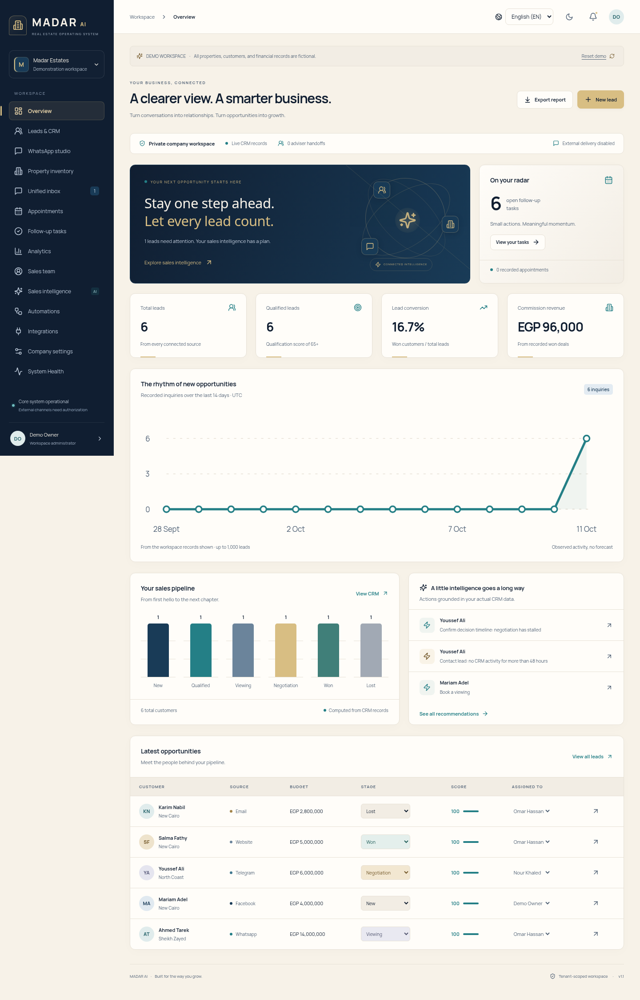

# MADAR AI · Real Estate Operating System

A real estate operations workspace for Egypt and the Gulf, with a React/TypeScript dashboard and a tenant-scoped FastAPI backend.

The working local journey is **website inquiry → bilingual qualification → verified property matching → CRM → viewing booking → follow-up → analytics**. All seeded demo data is fictional. The rules assistant operates without external services; a real language model is optional and not yet authorized here.

Telegram now supports local Docker long polling, secure guided setup, bilingual inventory recommendations, confirmed viewing bookings, consent and human handoff. Start with [Telegram setup](docs/telegram-integration.md); [verification](docs/telegram-verification.md) separates automated checks from unverified live delivery. No public endpoint is needed and Telegram sending stays disabled until you enable it.

The interactive demonstration now includes a connected Egyptian portfolio: **30 listings, 40 customers, 25 conversations, 15 viewings, 20 tasks and five sales agents**. Bundled distinct photorealistic synthetic images, actual-record analytics and demo-only Load/Reset keep presentations polished and real company records isolated. See [demo dataset and Windows instructions](docs/demo-dataset.md).

The real **`madar`** workspace now supports administrator-confirmed **Company settings → Load Sample Business Data**. It copies the same fictional portfolio without changing Telegram configuration or existing records. Tracked samples cannot receive external messages; removal is blocked when genuine records depend on sample inventory. Business analytics distinguish genuine activity from imported examples. [Windows update and Telegram demonstration steps](docs/sample-business-data.md).

## Premium product upgrade

The midnight navy, sapphire, champagne gold, deep teal and warm ivory interface includes fourteen operational pages, self-hosted Manrope/Arabic typography, dark mode, mobile RTL and keyboard dialogs. The **WhatsApp studio** rehearses a complete fictional inquiry → qualification → inventory → viewing → human handoff/opt-out journey without Meta or paid-model requests. Fourteen inactive n8n exports include eight business canvases with 36–41 executable nodes each, a real isolated full-demo orchestrator, and delivery/error support modules. System Health distinguishes actual checks from unverified Windows/provider execution. All 14 n8n exports use clean, functional-node-only layouts; existing workflow IDs are updated by `Update-Madar.cmd` without duplicate imports. See [layout verification](docs/workflow-layout-verification.md).

[View actual dashboard previews](docs/previews/README.md) · [Workflow architecture and SVG diagrams](docs/workflow-architecture.md) · [WhatsApp sandbox/live setup](docs/whatsapp-setup.md) · [PASS / FAIL / NOT VERIFIED report](docs/premium-verification.md)



## Arabic and English

Switch instantly between **العربية (AR)** and **English (EN)** across the complete interface. The preference persists locally; forms, selections and unsent messages survive switching. RTL/LTR, Noto Sans Arabic/Manrope, statuses, dates, numbers and currencies follow the locale. [Implementation and tests](docs/localization.md) · [Current milestone verification](docs/bilingual-verification.md) · [Enterprise continuation and actual node counts](docs/enterprise-continuation.md)

## Run on Windows

With Docker Desktop installed and your existing n8n running at `http://localhost:5678`, run from this folder:

```powershell
.\Start-Madar.cmd
```

Double-click **Start-Madar.cmd**, or use the command above. Enter a missing local key at the hidden prompt; existing keys are reused. Double-click **Update-Madar.cmd** for a protected fast-forward update, recovery preparation and startup. The launcher handles setup/startup, imports inactive workflows without duplicate workflow creation, checks every component, and opens the dashboard. Use `Start-Madar.cmd -ReplaceApiKey` only to replace the saved key. No host Python, Node or Bash is needed. See [Windows setup, PASS/FAIL reporting and local checks](docs/windows.md).

## Run locally

For your existing local n8n and Docker development, run **on your computer**:

```bash
bash scripts/local-dev.sh --replace-api-key
```

The hidden API-key prompt writes private ignored settings; ten workflows deploy inactive. Open **http://localhost:8000**. See [the local setup guide](docs/local-development.md) for native n8n, networking, JSON import and key explanations. `MADAR_AI_API_KEY` is optional and unnecessary for the rules assistant or n8n.

For source development / Cloud Web Preview, use Python 3.12+ and Node 24:

```bash
bash scripts/setup.sh
npm run dev
```

Use Web Preview on port **3000** (Vite) or the built application on port 8000 and select **Open interactive demo**. Each session receives a private seeded company. Company settings can provision an isolated empty client company. A standalone public website chat is served at `/chat?company=WORKSPACE_SLUG`.

For the initial real workspace, sign in with workspace `madar` and the configured administrator email. In development only, an initial private password is written to `var/initial-admin-password` (0600); it is never committed or logged. Production requires an explicitly injected password, HTTPS, and demo mode disabled. `.env.example` documents configuration names without credentials.

## Upgrade existing local data

Update this checkout on `codex/self-hosted-n8n`, preserve the private settings, deployment manifest and named MADAR volume, then rerun `Start-Madar.ps1` (omit `-ReplaceApiKey` if reusing the local key). The launcher creates no n8n instance. Startup adds operational tables without rewriting existing CRM tables; migration preservation is tested. Back up the SQLite database before a real-data upgrade using the existing backup guide. Inactive managed workflows are updated in place; active or ambiguous workflows fail safely and require local review. Import does not activate them.

## Verify

```bash
.venv/bin/python -m pytest -q
npm --prefix frontend run build
# Requires the application running and /usr/bin/chromium:
npm --prefix frontend run test:e2e
# Avoid unrelated existing APIs by selecting a loopback target when needed:
# MADAR_DEV_API_URL=http://localhost:8002 npm --prefix frontend run dev -- --port 3001
# MADAR_E2E_BASE_URL=http://localhost:3001 npm --prefix frontend run test:e2e
```

The API contract is available at `/api/docs`. Additive SQLite migrations 001/002 is in `backend/schema.sql`; repeatable initialization runs during startup. Local state is kept in ignored `var/`.

## What is implemented

- Tenant isolation, administrator/agent roles, Argon2 passwords, expiring HttpOnly sessions, password changes, audit records, and cross-site mutation guards.
- Contact deduplication, lead scoring, stage changes, least-loaded active-agent assignment, conversation history, tasks, and recorded deals/loss reasons.
- English/Egyptian Arabic inquiry parsing, customer intent, strict inventory matching, persistent human handoff, consent audit history, and self-service viewing slots with transactional conflict checks.
- Follow-up and reminder evaluation, availability tasks, dormant reactivation/retention queues, opt-outs, and an approval-gated delivery outbox.
- Luxury responsive light/dark dashboard, Arabic navigation and RTL, management metrics/report exports, property comparison, listing-copy drafts, and an editable ROI scenario calculator.
- Official Telegram and Meta webhook/dispatch adapters, Facebook Lead Ads fetch, message status updates, approved WhatsApp templates with text body parameters, and normalized email/CRM ingestion.
- Fourteen modular inactive n8n workflows and a direct API deployment tool; Docker preparation, backup helper, client customization guide, sales presentation, pricing assumptions, and portfolio draft.

## External access and current limits

The local website journey is functional. Live **your local n8n, WhatsApp, Telegram, Facebook/Instagram, email/CRM accounts, and model access remain unverified**. Codex Cloud cannot reach your computer; local scripts perform the required checks without sending credentials to Cloud. No external messages, production deployment, public content, or purchases have been performed.

This release uses one process and SQLite with persistent storage; it is suitable for evaluation and a hardened low-volume pilot. It is not a completed production SaaS launch. Each deployment binds one external-integration tenant; multiple CRM companies are isolated, but per-tenant channel credential storage, large-client pagination, MFA/recovery/SSO, billing, and external calendar synchronization require further work. Some operational UI labels remain English. Provider node compatibility and test-account delivery must be verified after authorization.

## Documentation

- [Windows one-command deployment](docs/windows.md)
- [Local Docker, n8n, secrets and preview](docs/local-development.md)
- [Architecture](docs/architecture.md)
- [Actual n8n workflow architecture](docs/workflow-architecture.md)
- [Official WhatsApp setup and sandbox](docs/whatsapp-setup.md)
- [Premium upgrade verification](docs/premium-verification.md)
- [Integration access and official providers](docs/integrations.md)
- [Deployment and operations](docs/deployment.md)
- [Client customization](docs/client-customization.md)
- [Commercial pack and demo script](docs/commercial.md)
- [Verification evidence and remaining work](docs/status.md)

Credentials belong in secure environment settings, never source control or chat. Real-customer messaging, production release, public publication, paid services, and production-data deletion require the owner’s explicit approval.

The enterprise release adds scoped demo capabilities, durable automation artifacts, adviser SLA cases and five grounded agents. [Enterprise verification and exact local demo steps](docs/enterprise-verification.md) include actual isolated n8n execution evidence and explicit live-integration limitations.
