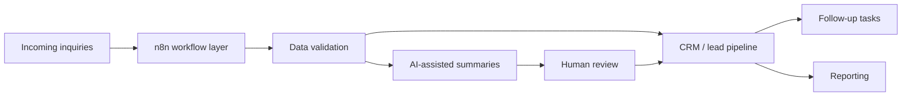

# Madar AI

**An AI-assisted real-estate operations platform — project concept and development roadmap.**

Madar AI explores how **n8n workflows, AI assistance, and a connected CRM** could reduce repetitive work for real-estate teams, from incoming inquiries to organized follow-ups.

> **Project status:** Early-stage concept / planning. This public repository currently contains documentation and a `.gitignore`; no runnable application or n8n workflow export is published here yet.

## The Problem

Real-estate teams can lose time switching between messages, spreadsheets, notes, and disconnected lead lists. Without a consistent workflow, inquiries may be missed and follow-ups can be difficult to track.

## Proposed Solution

Madar AI is being designed around a simple idea: **one organized workflow from lead intake to follow-up**, with human oversight and clear visibility.

### Planned Capabilities

| Module | Intended role |
| --- | --- |
| Lead intake | Capture inquiries from supported channels in a consistent format. |
| CRM workflow | Organize lead details, status, ownership, and next steps. |
| AI assistance | Suggest classifications, summaries, and draft follow-up messages for review. |
| Automation | Use n8n to route information, trigger tasks, and connect business tools. |
| Reporting | Help teams understand their pipeline and operational bottlenecks. |

These are **planned features**, not claims about a released product.

## Proposed High-Level Architecture



Actual integrations, data models, and services will be documented when an implementation is added.

## Design Principles

- **Human-in-the-loop:** review consequential external messages and AI-generated suggestions.
- **Reliability:** validate input, prevent duplicate actions, and plan for failures and retries.
- **Privacy:** avoid publishing customer records, credentials, or private business data.
- **Clarity:** document each workflow, its triggers, expected outputs, and limitations.

## Roadmap

- [ ] Define an MVP use case and measurable success criteria.
- [ ] Design the lead and CRM data structure.
- [ ] Build and export a first n8n workflow.
- [ ] Add error handling, deduplication, and logging.
- [ ] Document setup with sanitized sample data.
- [ ] Record a walkthrough of a working end-to-end demo.

## Repository Contents

```text
madar-ai/
├── README.md       # Product concept, architecture and roadmap
└── .gitignore      # Local development exclusions
```

## Demo & Setup

A runnable demo and installation instructions are **not available in this public repository yet**. They will be added alongside executable code or workflow exports.

## About

Developed by [Shaimaa](https://github.com/shaimaamo1), with a focus on Python, AI-assisted workflows, and business automation.
