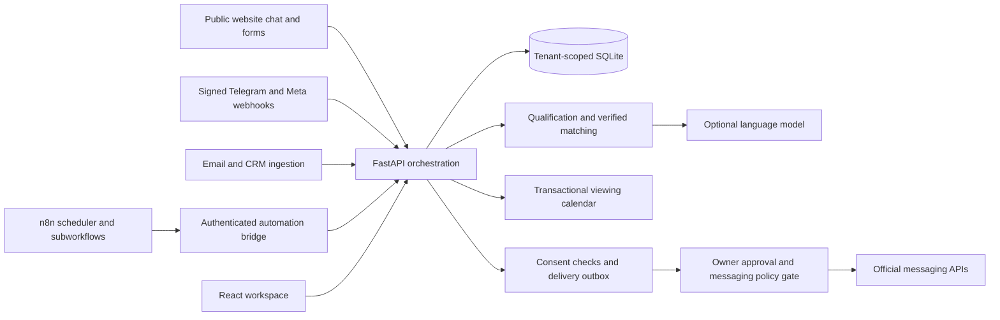

# MADAR AI architecture

MADAR connects website inquiries, CRM records, property matching, appointments, follow-up evaluation, and analytics through one tenant-scoped API. The working local product needs no external account or paid subscription.

The API owns validation and transaction boundaries; n8n owns production workflow scheduling and external input orchestration. Local manual evaluation and `python -m backend.worker` are fallbacks while n8n access is pending. Run only one scheduler per deployment. A crash after an external send can leave `Sending` or `Uncertain` records: reconcile provider delivery before retrying. Exactly-once delivery across network failures is not guaranteed.

`backend/schema.sql` is migration 001. It creates tenants, users, hashed sessions, leads, properties, messages, appointments, tasks, deals, activities, outbox, webhook receipts, and anonymous chat sessions. Foreign keys are enabled on every connection. Bootstrap is repeatable. SQLite WAL and `BEGIN IMMEDIATE` protect booking and event check/insert operations. This release targets a single application process and a persistent disk; horizontally scaled service instances require PostgreSQL, shared rate limiting, and a distributed delivery claim mechanism.

All authenticated business queries use the session user’s tenant. API inputs reject unknown fields and never accept a caller-selected tenant ID. Public chat sessions are random bearer capabilities stored only as hashes and scoped to a company. Public booking derives customer and tenant identity from that capability. Integration tokens are bound to one explicit `MADAR_INTEGRATION_TENANT_ID`, never a request body. Administrators manage inventory, settings, accounts, and automation; agents work with their company’s CRM. Agent-level record restrictions are not implemented; every agent sees their company’s records.

The rules assistant extracts common English and Egyptian Arabic budget, area, intent, type, and bedroom expressions. It ranks available inventory using strict requirements and explains matches. It is a deterministic assistant, not a connected generative AI service. An optional model may assist with preference interpretation after access is configured; property recommendations and prices remain grounded in stored inventory. Model access is unverified in this environment. Geographical alias coverage is deliberately bounded; unknown areas require explicit CRM preferences.

Analytics use recorded events: qualified means score ≥65, lead conversion is won customers / customers, sales volume sums won deal amounts, revenue sums won commissions, open pipeline sums open deal amounts, viewing completion is completed / all recorded appointments, and response time pairs incoming messages with their next outgoing response. The browser displays up to 1,000 records per collection; server analytics include all records. Add pagination before large-client rollout.

No historical growth percentages, live-provider statuses, earned revenue forecasts, or fabricated appointments are shown. Inventory illustrations are decorative; all seeded listings are fictional. Currency is company-wide; demo Dubai listings use the workspace currency until the owner chooses a different currency. Foreign exchange conversion is not implemented.
