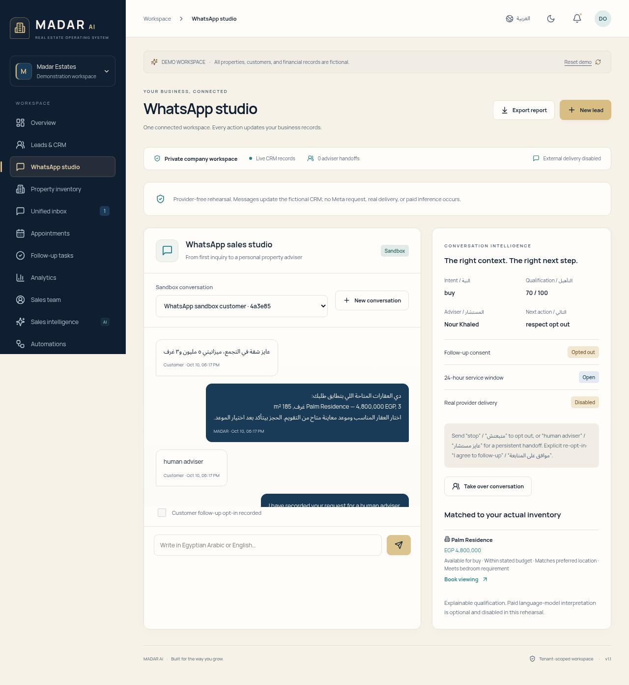
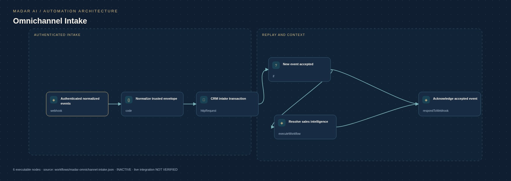

# Captured product previews

These are Chromium captures of the implemented application using fictional, isolated demo data. They are not mockups. The workflow SVGs are rendered from the actual inactive JSON exports; they are not evidence of execution on n8n. No customer records, keys or live provider accounts appear here.

| View | Preview |
| --- | --- |
| Executive dashboard | [Overview](overview.png) |
| Midnight theme | [Dark dashboard](midnight-dashboard.png) |
| Arabic mobile | [RTL mobile](arabic-mobile.png) |
| Login | [Sign-in](login.png) |
| CRM | [Leads](leads-crm.png) |
| WhatsApp conversation | [Working sandbox](whatsapp-conversation.png) |
| WhatsApp studio | [New conversation](whatsapp-studio.png) |
| Inventory | [Properties](property-inventory.png) |
| Inbox | [Unified inbox](unified-inbox.png) |
| Appointments | [Viewings](appointments.png) |
| Follow-up tasks | [Tasks](follow-up-tasks.png) |
| Sales analytics | [Analytics](analytics.png) |
| Team | [Sales advisers](sales-team.png) |
| Intelligence | [Next best actions](sales-intelligence.png) |
| Automation | [Workflow studio and outbox](automations.png) |
| Integrations | [Channel setup](integrations.png) |
| Settings | [Company configuration](company-settings.png) |
| Actual intake architecture | [Rendered PNG](omnichannel-architecture.png) · [Scalable SVG](../diagrams/madar-omnichannel-intake.svg) |

The browser suite regenerates application captures in this directory. It requires a local API with demo mode on and external/model flags off. Repeated runs against one long-lived API can hit the deliberate 10-demo-sessions/5-minute rate limit; use a fresh isolated test API/container or wait for the window. The tests do not weaken that protection. All ten module diagrams regenerate using `scripts/generate_architecture.py`.

Typography is self-hosted Manrope and Noto Sans Arabic from the Google Fonts repository, with their SIL Open Font License texts bundled under `frontend/public/fonts/`. No font CDN request is required by the dashboard.
