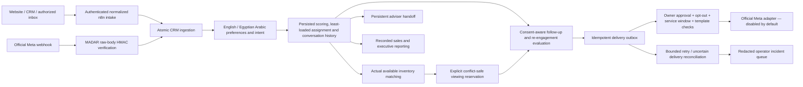

# MADAR automation architecture

The ten modules are generated from `scripts/generate_workflows.py`. Their diagrams and dashboard catalog are generated from those actual JSON files by `scripts/generate_architecture.py`. Sticky notes are visual groups, not executable nodes. Every HTTP operation maps to an implemented, tenant-bound backend contract; there are no decorative processing steps.



## Importable modules

| Module | Real operation | Diagram |
| --- | --- | --- |
| Omnichannel Intake | Header-authenticated normalized event webhook, validation, atomic CRM ingest, replay branch, linked intelligence subworkflow, acknowledgement | [SVG](diagrams/madar-omnichannel-intake.svg) |
| Ingestion Subworkflow | Reusable event envelope validation and CRM ingestion; qualification, scoring, assignment, matching and conversation synchronization commit together | [SVG](diagrams/madar-ingestion-subworkflow.svg) |
| Lead Intelligence | Read recorded intent/score, missing fields, assigned adviser and matching inventory; ensure deduplicated handoff task or return next actions | [SVG](diagrams/madar-lead-intelligence.svg) |
| Viewing Reservations | Explicit request validation, idempotent reservation with transaction-based conflict checks, confirmation output | [SVG](diagrams/madar-viewing-reservations.svg) |
| Follow-up Scheduler | Five-minute due-task/reminder/reactivation evaluation; read server authorization; dispatch only through the server gate or return queued sandbox status | [SVG](diagrams/madar-follow-up-scheduler.svg) |
| WhatsApp Delivery | Operator evaluation, authorization branch, WhatsApp-only outbox dispatch through the official adapter; provider-free disabled output | [SVG](diagrams/madar-whatsapp-delivery.svg) |
| Sales Reporting | Daily aggregate CRM metrics and an executive report artifact; no automatic email or publishing | [SVG](diagrams/madar-sales-reporting.svg) |
| Delivery Reconciliation | Fifteen-minute review of Failed/Uncertain records; deduplicated dashboard incidents and operator review branch; no uncertain retries | [SVG](diagrams/madar-delivery-reconciliation.svg) |
| Error Monitor | Error trigger, fixed-category redaction, idempotent dashboard incident; no external notification | [SVG](diagrams/madar-error-monitor.svg) |
| Test Evaluation | Manual follow-up evaluation and operational status; no dispatch node | [SVG](diagrams/madar-test-evaluation.svg) |

All exports are **inactive** and retain no successful/error execution payloads. Real n8n node compatibility, scheduler behavior, webhook authentication and error-trigger execution are **NOT VERIFIED** until tested on the owner's actual installation. Diagram validity does not establish n8n runtime validity.

## Contracts and idempotency

`POST /api/integrations/ingest` uses the ingestion token and accepts:

```json
{"event_id":"stable-source-event-id","lead":{"name":"Authorized source contact","source":"crm","consent":false},"text":"New Cairo apartment, budget 5 million"}
```

The Omnichannel webhook passes the same envelope at `/webhook/madar-intake` **only after an explicitly approved local activation**. Its n8n Header Auth credential uses the private ingestion bearer token. Boolean `true` is required for recorded opt-in; string truthiness never grants it. Field/model validation and tenant binding are enforced again by MADAR. Official WhatsApp incoming events go directly to the signed Meta adapter, with no dependency on an activated n8n intake webhook.

Bridge-token contracts are `POST /api/bridge/intelligence`, `/handoff`, `/appointments`, `/tick`, `/status`, `/dispatch`, `/whatsapp/dispatch`, `/report`, `/incidents`, and `/reconcile`. The token selects the server's integration tenant, never a caller-supplied tenant. Intelligence accepts `{"lead_id":"CRM_ID"}`. Handoff accepts that reference, `active` and an allowed fixed reason. Booking accepts:

```json
{"event_id":"stable-booking-confirmation","appointment":{"lead_id":"CRM_ID","property_id":"LISTING_ID","agent_id":"ADVISER_ID","start_at":"2030-01-01T10:00:00+02:00"}}
```

Booking retries must reuse exactly the same event ID and payload. Conflicting appointments return 409 and never silently move a customer's time. HTTP retries are bounded to three attempts; backend event/outbox/reservation deduplication protects repeated effects. Failed delivery retries have a separate five-attempt budget and delay; Uncertain delivery requires reconciliation.

## Existing n8n upgrade

The Windows launcher builds only MADAR and imports all ten modules into the existing n8n. No duplicate n8n instance is created. The deployment helper orders referenced modules before callers, resolves the `MADAR_WORKFLOW:` placeholder to the actual n8n workflow ID, binds the two Header Auth credentials, and attaches the Error Monitor. Those names are **placeholders**, not live IDs in standalone JSON: manual UI import requires selecting **MADAR Lead Intelligence** on the Omnichannel execute-workflow node and binding credentials/error workflow locally.

The original four workflow names and node identities are retained. Existing manifests reuse their recorded IDs. If the manifest is lost, both recognized legacy node sets and the complete upgraded sets can be adopted; unknown/empty same-name graphs are refused. Ambiguous names, manifest mismatches and active managed workflows fail before workflow mutations. Deactivate a managed workflow yourself before importing an upgrade; the helper never activates or deletes it. Preserve `var/n8n-deployments/` and your n8n backups. Manual imports cannot promise idempotency; use the API importer for repeated setup.

After importing, manually execute **MADAR Test Evaluation** and inspect its operational result. Locally test **Lead Intelligence** with a real CRM ID and **Viewing Reservations** with a fictional explicit appointment. Test failure escalation only with fictional fixture data and approved local activation when required by n8n's Error Trigger. Schedule timezone follows the n8n instance; appointment enforcement uses each company's configured Cairo/Dubai/Riyadh timezone. Real delivery and paid inference stay disabled.

## Regenerate artifacts

```bash
.venv/bin/python scripts/generate_workflows.py
.venv/bin/python scripts/generate_architecture.py
npm --prefix frontend run build
```

Automated tests compare dashboard/SVG nodes and edges to these exports, validate backend contract resolution and dependency ordering, execute normalized-envelope JavaScript with local fixtures, and mock deployment of the legacy four into ten inactive modules. They do not launch n8n or contact the owner's localhost.
